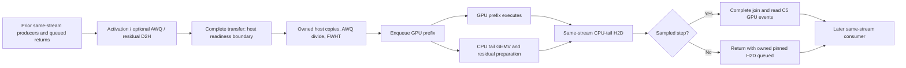

# Passback phase 2 — fixed-share counterfactuals and rejected rotation overlap

**Lifecycle:** `historical`. **Disposition:** fixture-bound measured investigation; rotation-overlap candidate **rejected and reverted**. Not an admission, product claim, or automatic baseline. Campaign label: 2026-10-16; receipts were collected on 2026-10-17 UTC.

**Outcome: no reproducible additional native decode-throughput improvement established.** Retained C4+C5 is unchanged. Neither a global fixed-share change nor the tested host-rotation overlap meets the comparison criterion. All temporary diagnostic and candidate production edits were removed. User-owned `WATCHDOG.yml` was left untouched. The deliverable is this report and its evidence bundle, not a production-code change.

This is a new, append-only record. Earlier checkpoints remain unchanged. Full receipts: [data-2026-10-16-passback-phase2-gfx1201/](data-2026-10-16-passback-phase2-gfx1201/), with `SHA256SUMS`; no executables are included.

## Starting point and identity

Read the complete prior [campaign summary](2026-10-16-passback-optimization-summary-gfx1201.md), retained [C4](2026-10-16-passback-asynchronous-split-returns-gfx1201.md)/[C5](2026-10-16-passback-sampled-gpu-event-timing-gfx1201.md), rejected [C1](2026-10-16-passback-timing-interval-experiment.md), [C2](2026-10-16-passback-shape-isolation-experiment.md) and its [amendment](2026-10-16-passback-shape-isolation-experiment-amendment-1.md), [C3](2026-10-16-passback-pinned-copy-worker-experiments.md), and [C6](2026-10-16-passback-frozen-sampling-experiment.md). No rejected scheduler-key or sampling experiment was repeated.

| Artifact | Identity |
|---|---|
| Source | `a5a87e6cdd67af97e03482423a997552de50f98f`, `perf/passback-opt`; C4+C5 retained, C6 absent |
| Host | Ryzen 7 7800X3D, approximately 28 GB RAM; Radeon RX 9070 XT gfx1201, 16,304 MiB VRAM; HIP 7.2, hipcc 7.2.53211 |
| Toolchain/build | rustc 1.98.1; workspace `cargo build --release`, not a package-only build |
| Rebuilt C4+C5 CLI / daemon md5 | `3413c7bdfe10a1b79abbe63d4f3db452` / `f6cb5fec835e6fede7bbddf28ff5b828` |
| Candidate CLI / daemon md5 | `bbd6e077bf20f357a0cb83ee4d1c2a4b` / `f82f4fbac5155cafab41d70210ce8818` |
| Diagnostic CLI / daemon md5 | `c9b1166dfe3d209206564883cea3672e` / `75351a33a1c088db30891e0545200095` |
| 9B | `~/.hipfire/models/qwen3.5-9b.mq4`; md5 `296092bf1e6a45d78c1acf815eb93366`; 5,313,750,016 B; budget 16 resident / 16 spilled; q8/q8 KV, VMM |
| 27B | `~/.hipfire/models/qwen3.8-27b.mq4`; md5 `d1292b4d5bd6046693604201a6ca8074`; 15,662,615,552 B; budget 56 resident / 8 spilled; fp8 KV, VMM |
| Prompt | `benchmarks/prompts/gpu_offload_probe.txt`; md5 `5835c71e471849b4a72e1dc8e39695e7`; 215 B / 59 tokens |
| Candidate patch SHA-256 | `5c782b7f16040bbeaee82c695d56725907a4abb56987cbbe923fb8aaecb86f17` |
| Temporary diagnostic patch SHA-256 | `1389c04e0526c72262a8bff8ea4485e433d01fa6c2f0d3f3c3f663196d2c8985` |

These rebuilt baseline binaries, not the original pre-C4 campaign binaries, ran every current comparison. Different binary hashes from the earlier report do not establish a performance change; this record pins the actual executables used.

**Receipt correction:** `PROVENANCE/provenance.txt` contains a shortened, incorrectly transcribed candidate patch digest. The complete digest above was computed from the archived patch with `sha256sum`; the patch and integrity manifest are authoritative. The transcription receipt is preserved unchanged.

## Native protocol and comparison rule

```sh
hipfire bench MODEL --runs 3 --warmups 3 --spec off \
  --backend noslots --workload stateless --max-tokens 128 --max-seq 4096 \
  --kv-mode auto --kv-backend vmm \
  --prompt-file benchmarks/prompts/gpu_offload_probe.txt --json
```

Fresh CLI/daemon and isolated configuration/lock directories per sample; `HIPFIRE_LOCAL=1`, `HIPFIRE_NO_REGISTRY_FETCH=1`, `HIPFIRE_DPM_WARMUP_SECS=10`; explicit offload mode, budget and share. Rayon unset, normal affinity, no quant/SIMD changes. GPU runs were serialized and delegated exclusively to the benchmark runner. Full native JSON arrays, telemetry, stderr and per-invocation daemon/CLI md5 proofs are retained.

One sample is the median of three internal measured runs after three warmups. Internal rows are not independent processes. Sweep: N=3 processes per share/model with rotated order. Candidate: two balanced blocks, ABBAABBA and reversed BAABBAAB, N=4 processes per arm/model/block. Statistics below use population standard deviation of process medians.

Predeclared retention: a native trace-off improvement must reproduce in reversed order, resolve against contemporaneous process scatter, transfer to both models, and preserve correctness/fallbacks. A better component timing alone is insufficient. No statistical-confidence claim is made from these small samples.

The short prompt is unsuitable for a prefill throughput claim. Only fixture-bound native decode comparisons are drawn; no production-throughput admission or quality pin is claimed. Native requested token counts are not independent finish-status proof; serve receipts supply decoded text and finish reasons separately.

### Exclusions and provenance limits

An early partial sweep ran under host memory pressure from a separate CodeGraph indexer (about 13.5 GiB RSS). Three successful samples and subsequent OOM-guard refusals are excluded. The user stopped that indexer; the full sweep restarted with approximately 18–20 GB available memory and flat swap. No OOM guard was bypassed. Eight broken reverse-runner attempts and a pilot are also segregated under `EXCLUDED/`, not counted as process samples.

Initial candidate ABBA logs contain zero diagnostic/trace lines, but its environment receipt did not explicitly list `HIPFIRE_SPLIT_DIAG`. Reverse samples explicitly cleared and recorded that variable and likewise contain zero diagnostic lines. Original orchestration scripts are preserved; reverse orchestration used the separately archived Python runner.

## 1. C4+C5 dependency timeline

Baseline source references below belong to restored source at `a5a87e6c`, not the temporary diagnostic's shifted line numbers.



- `cpu_exec.rs::cpu_arm_prepare` (637–668), `prepare_split_read` (684–730): activation/AWQ/residual reads enqueue into reusable pinned storage; `complete` precedes any host read; owned vectors and transforms precede launch.
- `offload_split.rs::run_with` (992–1036): sampling decision, preparation, sampled C5 start marker, prefix launch, stop marker, CPU finish and optional observation. `gemv_ns` is multiply-only; GPU elapsed is read after the existing sampled H2D completion.
- `cpu_exec.rs::upload_arm_result` (748–777): sampled split returns complete; unsampled returns enqueue only. Whole-CPU routes retain completed returns.
- `cpu_exec.rs::with_cpu_transfer` (1999–2036): thread-local pinned owner reuses capacity on the warm same-device path. Growth/device changes retire the old owner; error paths drain or retain storage. These exceptional drains are not established steady-state costs.
- `hip-bridge/src/ffi.rs::PinnedTransferBuffer::{complete,as_bytes_mut,begin}` (3353–3389): host access requires `pending=false`; ordinary completion synchronizes its stream; stream transitions drain safely. Deferring completion while reading pending storage is invalid.

Multi-row correctness was a preservation constraint, not a claim that splitting output rows itself proves multi-token behavior. Eligibility originates in `cpu_exec.rs::plan_step` (1846–1877), which admits `Gemv`/`GemvResidual`; fallback paths were left unchanged.

## 2. Four scout findings, critically evaluated

| Investigation | Source-backed finding | Decision / uncertainty |
|---|---|---|
| A — dependencies | `run_with` prepares before launching; `prepare_split_read` folds wait, copy, allocation/copy and transforms into its phase. Residual CPU rows are read before concurrent writes. | Current full-stream completion cannot simply move after prefix launch: that would drain the prefix. A redesigned same-stream event boundary is conceivable; a second stream is not inherently required. Not implemented or validated. |
| B — scheduler | `offload_split.rs::ShapeState`, `observe`, `sample_due`, `run_with`: `(dtype,k)` state, EWMA, slew/latch/reopen; real concurrent GPU duration and CPU multiply duration; one-in-four LCG sampling. Numeric share override already exists. | Sweep before replacing policy. Counterfactuals below establish no robust auto deficit. Solo probes are seeds, not optimality proof under contention. |
| C — memory traffic | `prepare_split_read`: k activation floats, optional k scale floats, optional tail residual floats stage to pinned storage and then owned vectors. CPU weight rows are sliced from host-mapped storage; GPU prefix reads its disjoint rows over PCIe. | Repeated AWQ-scale D2H and vector copies are hypotheses, not measured dominant costs. Pointer-key caches would need model-lifecycle invalidation; none added. Theoretical bandwidth/flop estimates were rejected as timing evidence. |
| D — transfers | `upload_arm_result`, `with_cpu_transfer`, bridge owner: unsampled returns already avoid the host join; storage remains owned/pending until safe reuse. | No evidence for a hot-path allocation/device-sync bottleneck. Any input-ready event API must preserve pending ownership, error drains, stream changes and teardown. No polling or multi-owner cache introduced. |

Read-only scouts made no edits or measurements. Parent review corrected initial claims that a second stream was mandatory, that exceptional owner drains were hot-path overhead, and that host memcpy dominated FWHT based on theoretical rates.

## 3. Fixed-share counterfactuals

All values are process medians in decode tok/s, N=3 per cell. Sorted samples do not represent temporal execution order; scripts/meta retain actual order.

| Model | Share | Process medians | Median | Population SD |
|---|---|---|---:|---:|
| 9B | auto | 20.8, 21.0, 21.0 | 21.0 | 0.094 |
| 9B | 0.25 | 18.8, 19.4, 19.6 | 19.4 | 0.340 |
| 9B | 0.375 | 20.3, 20.6, 21.2 | 20.6 | 0.374 |
| 9B | 0.45 | 19.1, 20.1, 20.2 | 20.1 | 0.497 |
| 9B | 0.5 | 19.0, 19.2, 19.2 | 19.2 | 0.094 |
| 27B | auto | 16.2, 16.9, 17.3 | 16.9 | 0.455 |
| 27B | 0.25 | 16.5, 16.9, 16.9 | 16.9 | 0.189 |
| 27B | 0.375 | 16.9, 17.2, 17.4 | 17.2 | 0.205 |
| 27B | 0.45 | 16.4, 16.5, 16.5 | 16.5 | 0.047 |
| 27B | 0.5 | 15.2, 15.7, 15.7 | 15.7 | 0.236 |

Best fixed share 0.375 is −1.9% versus auto on 9B and +1.8% on 27B, with overlapping process ranges on both. This does not prove mathematical optimality, especially per projection or phase, but provides no robust case for changing the scheduler. Share 0.5 is slower on both fixtures. No exact-shape key expansion, sampling reduction or fixed-default change was implemented.

## 4. Diagnostic critical-path breakdown

Temporary `HIPFIRE_SPLIT_DIAG=1` added gated host clocks only, alongside existing C5 trace/event timing. It split the host preparation into readiness completion, staging, AWQ/FWHT, return preparation and sampled join. Diagnostic runs used one measured request after three warmups; they are attribution-only, not headline samples. Patch archived then removed before candidate measurements.

The following are **late-window marginal means**, obtained by differencing consecutive cumulative power-of-two reports per real shape and sampled flag. Rounded values are microseconds per split step. `d2h` still means producer+copy completion, not physical D2H. AWQ/FWHT is combined; rotation alone was not separately isolated.

| Model / actual shape | Sampled? | D2H readiness | Staging | AWQ/FWHT | CPU GEMV | Return prep | H2D join | C5 GPU arm |
|---|---|---:|---:|---:|---:|---:|---:|---:|
| 9B m12288/k4096 plain | yes | 54.5 | 1.3 | 0.0 | 418 | 1.5 | 81.2 | 462.5 |
| 9B m4096/k12288 rotated residual | yes | 57.6 | 3.3 | 19.7 | 438 | 1.5–1.6 | 50.3 | not separately quoted |
| 9B m4096/k12288 rotated residual | no | 74.2 | 3.3 | 20.5 | 437 | 1.5–1.6 | queued | unmeasured |
| 9B m4096/k4096 rotated residual | yes | 56.8 | 2.1–2.2 | 6.4 | 209 | 1.3–1.4 | 42.5 | not separately quoted |
| 27B m17408/k5120 plain | yes | 61.6 | 1.5 | 0.0 | 693 | 2.0–2.1 | 123.5 | 793 |
| 27B m5120/k17408 rotated residual/AWQ | yes | 109.0 | 4.3–4.5 | 29.6 | 724 | 1.9 | 62.1 | not separately quoted |
| 27B m5120/k17408 rotated residual/AWQ | no | 95.2 | 4.3–4.5 | 30.8 | 734 | 1.9 | queued | unmeasured |
| 27B m5120/k6144 rotated residual/AWQ | yes | 59.3 | 2.6–2.7 | 11.1 | 300 | 1.7–2.5 | 49.0 | not separately quoted |

Sampled and unsampled values are descriptive observations from one profiled process, not proof that instrumentation/sampling has no distortion. GPU-arm and host intervals overlap: do not add them as independent latency. Sampled joins combine return completion with uncovered GPU wait; unsampled H2D is queued. A residual `other` host bucket exists in raw logs but is not interpreted as uncovered GPU synchronization.

**Unresolved measurement:** physical D2H/H2D time, producer-only completion latency and actual uncovered GPU synchronization are not isolated. An optional `=events` diagnostic implementation was archived but not run; per-step event creation plus extra producer synchronization would perturb those boundaries and only bound stream transfer spans, not measure physical copies alone.

**Withdrawn analysis:** an intermediate runner summary divided cumulative windows by 128 to estimate per-token prep/wall fractions. Those windows span warmups and unequal per-shape call counts; the denominator was unproved. No such per-token budget or wall percentage is claimed here.

## 5. Candidate selected, implementation and rejection

**Only implemented optimization:** defer split-arm host `rotate_x` from `prepare_split_read` until `cpu_arm_finish`, after the GPU prefix is enqueued and before the CPU GEMV timer. D2H readiness, vector staging and AWQ division stayed before launch. The owned activation was rotated in place: no new allocation/copy, event, stream or synchronization. Whole-CPU preparation still rotated normally; share0, CPU/PCIe fallback and sampling policy were unchanged. Mutable arm callers were migrated for the experiment and reverted with it.

Measured justification was the roughly 20–31 µs combined transform slice on the large rotated shapes. Only FWHT moved, so that slice was an upper bound on the targeted work. This deliberately small experiment avoided a speculative event-owner redesign. C5 CPU observations remained GEMV-only; omitting newly overlapped rotation from the scheduling interval was a modeling tradeoff, not a claim of an optimal controller. No causal explanation for the resulting null is established.

| Model / block | Baseline process medians | Candidate process medians | Baseline median | Candidate median | Change |
|---|---|---|---:|---:|---:|
| 9B ABBA | 20.5, 20.5, 21.1, 21.6 | 20.5, 20.6, 20.6, 20.9 | 20.8 | 20.6 | −1.0% |
| 9B reverse | 20.1, 20.5, 20.7, 20.7 | 20.0, 20.2, 20.6, 20.6 | 20.60 | 20.40 | −1.0% |
| 27B ABBA | 16.9, 17.2, 17.4, 17.8 | 17.1, 17.2, 17.8, 17.9 | 17.3 | 17.5 | +1.2% |
| 27B reverse | 16.9, 17.0, 17.2, 17.2 | 17.1, 17.2, 17.3, 17.5 | 17.10 | 17.25 | +0.9% |

Every block's process ranges overlap. Population SDs, baseline/candidate: 9B ABBA 0.460/0.150, reverse 0.245/0.260; 27B ABBA 0.327/0.354, reverse 0.130/0.148. Pooling two blocks gives medians 20.6/20.5 on 9B (−0.5%) and 17.2/17.3 on 27B (+0.6%); pooling does not remove block effects or establish confidence. No both-model reproducible gain clears the criterion. Candidate fully reverted; frozen patch remains as rejected evidence.

## 6. Correctness evidence and limits

The benchmark runner exercised the candidate before timing:

- Dispatch library: 410 passed / 1 ignored.
- `passback_row_offset_equivalence`: 18 cases × three stream modes, reported bit-exact.
- `cpu_offload_return_stream_and_reuse_parity`: reported PASS.
- Channel suite: reported 17 passed / one gfx1151-only skip.
- Candidate serve battery/chain on both exact fixtures, greedy, thinking off, max_seq 4096, max_tokens 128. Battery: three stop and two length-cap responses per model; no empty/attractor rows. Decoded content was read: valid merge routine or cap-truncated code/math, coherent seasons/prose/instructions.
- Share0 versus CPU identity smoke: 506/506 decoded characters identical on this fixture. This is not an auto-share golden or cross-engine identity claim.

**Evidence limitation:** build and test results above were observed in tool output by the benchmark runner, but separate raw build/oracle logs were not saved. `PROVENANCE/commands.txt` records commands and reported results, not a replacement raw test log. Full serve JSON/logs and native benchmark receipts are durable. No additional test receipt is invented.

**Candidate 27B chain exception:** the lighthouse prose turn produced an immediate stop with `gen=1`, empty content, `empty=true`, `attractor=false`, no stream error, cached=438. The next turn decoded normally. No identical baseline-chain comparator was run; neither regression nor nonregression is established. This is not universally green generation correctness. The candidate was rejected independently for performance and removed. No state-parity claim is inferred from a subsequent successful turn.

After restoration, frozen C4+C5 binaries exercised final serve batteries on both models: each had **three stop / two length-cap** responses, no empty/attractor rows. Final 27B code was a complete merge routine; math/prose hit the 128-token cap; factual/instruction rows were coherent. Final smoke uses the original frozen baseline build after source restoration, not stale candidate executables.

No new capture/replay implementation was retained. This campaign did not rerun Redline certification or claim capture compatibility; the earlier campaign documents the CPU/passback retained-replay refusal and resident-only parity scope. Serve output is not a substitute for numerical/state parity or quality admission.

## 7. Remaining bottlenecks and next experiment

1. **Producer/D2H readiness boundary:** measured host completion windows remain approximately 40–109 µs per step on the quoted late windows, larger than host staging/transform slices. Avoidable fraction remains unknown.
2. **Same-stream event-ready hypothesis, unimplemented:** enqueue all input/residual D2H, record a readiness event, enqueue GPU prefix, then host-wait only for the readiness event before accessing staging. Unlike moving a full-stream sync, that event would not wait for the later prefix. This could hide host wakeup/preparation under the prefix, but requires an ownership-safe pending-completion API, precise failure handling, stream/device reuse proof and numerical oracles. It may increase host-RAM/PCIe contention. No throughput win is inferred.
3. **Sampled return joins:** 30–124 µs observed spans include GPU wait and transfer completion; they are not pure transfer waste. C6 sampling reduction remains rejected; quarter-rate sampling is preserved.
4. **Scheduler:** leave auto unchanged absent a robust counterfactual deficit. Global fixed-share sweeps do not settle per-shape or transient optimality.
5. **AWQ/static memory traffic:** lifecycle-owned host scales might eliminate repeated downloads, but current evidence does not justify a pointer-key cache or owner redesign. No related code was added.

The next bounded experiment should test the input-ready event boundary, not repeat C2/C6 or tune SIMD/Rayon. Before retention: fixed-share numerical/stream-reuse oracles, multi-row/fallback coverage, decoded serve battery/chain, then trace-off fresh-process A/B with reversed order on both fixtures. A reduced component duration without shorter native decode latency is still a rejection.

## Durable evidence inventory

[Evidence directory](data-2026-10-16-passback-phase2-gfx1201/) contains 393 files including integrity metadata:

- `SWEEP30/`: 30 accepted sweep processes, full JSON/meta/stderr/daemonproof.
- `ABBA32/`: 32 candidate comparison processes across two models/two orders, same four receipt types.
- `DIAG/`: original C5 trace and temporary host-only diagnostics for both models.
- `CORR/`: baseline and candidate serve results, identity smoke, restored-baseline final batteries and logs.
- `SCRIPTS/`: exact orchestration/analysis scripts. These are developer orchestration of existing native facilities, not a replacement benchmark instrument.
- `PROVENANCE/`: commands, source patches and identity receipt; digest transcription correction stated above.
- `EXCLUDED/`: memory-pressure partial block, failed runner attempts and pilot, excluded explicitly.
- `SHA256SUMS`: archive integrity; copies were byte-compared by the runner.

No permanent production source, tests, scheduler settings, quantization, SIMD, Rayon configuration, or design-default changes remain from phase 2. This report is the durable outcome, including the failure to meet the primary throughput objective.
