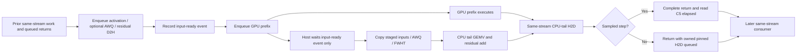

# Passback Phase 3, Step 1 — input-ready events

**Lifecycle:** `historical`. **Disposition:** implemented and validated for a controlled throughput comparison; **no throughput improvement, retention decision, or product admission claimed**. Scope ends at the input-ready boundary. The adaptive share controller is unchanged.

**Result:** the same-stream event boundary is safe on the exercised paths. Correlated kernel/API traces demonstrate that the **current step's own GPU prefix can execute before host input preparation finishes**, including cases where it starts before the host readiness wait returns. This is instrumented execution evidence, not a universal earlier-start guarantee or a trace-off speedup.

This follows the unimplemented hypothesis in [Phase 2 §7](2026-10-16-passback-phase2-gfx1201.md). Earlier checkpoints are unchanged. Raw receipts, the final production patch, temporary marker patch, profiler CSVs and `SHA256SUMS` are in the [evidence bundle](data-2026-10-17-passback-phase3-input-ready-gfx1201/).

## Identity and scope

| Item | Identity / setting |
|---|---|
| Source base | `b236099f64779b0291f5b48ff4ec0aa68d872b40` plus the four-file production patch below |
| Final production patch SHA-256 | `f855d7b92c919e454ee4c364f903e3f762d7ede264b48c80c2f6bc45639d30e0`; archived as `FINAL2-production.patch` |
| Final CLI MD5 | `19cddd8b4b1dd6caa8190f139c93bebc` |
| Final daemon MD5 | `fb71e7d781a26671c8d8cb5ae6885e50` |
| GPU / toolchain | gfx1201; HIP `7.2.53211-3d9ef42`; rustc `1.98.1` |
| 9B | `qwen3.5-9b.mq4`, MD5 `296092bf1e6a45d78c1acf815eb93366`, 5,313,750,016 bytes; budget 16 resident / 16 spilled; q8 KV, VMM |
| 27B serving fixture | Phase 2's `qwen3.8-27b.mq4`, budget 56 resident / 8 spilled; fp8 KV, VMM. This is the Phase 2 custom fixture, **not** an assertion of the canonical MQ4XTS quality pin |
| Native smoke prompt | `benchmarks/prompts/gpu_offload_probe.txt`, MD5 `5835c71e471849b4a72e1dc8e39695e7`, 215 bytes / 59 tokens |
| Share | **0.5 only** for split diagnostics and serving; no fixed-share sweep |
| Generation | Greedy; **thinking explicitly off**; DFlash/MTP off |
| Native isolation | `HIPFIRE_LOCAL=1`, `HIPFIRE_NO_REGISTRY_FETCH=1`, `HIPFIRE_DPM_WARMUP_SECS=10`; Rayon unset; GPU execution serialized by the benchmark runner |

The source-orientation, event/ownership investigation and implementation were delegated separately; the benchmark runner owned builds, runtime validation and profiling. The parent reviewed the causal witness against the raw CSVs.

`POST`, `POSTFIX`, `RESTORED` and the earlier `FINAL` receipts are intermediate history, not interchangeable final identities. A formatter-expanded intermediate was isolated in a retained recovery stash; only the intended production regions were restored. The restored source was rebuilt and its numerical oracles rerun. **`FINAL2-production.patch` and its digest are the authoritative delivered production source**, not a reconstruction inferred from an earlier binary. The formatting spill is not in the delivered tree; the recovery stash was retained rather than discarded.

## What changed

- [`hip-bridge/src/ffi.rs`](../../crates/hip-bridge/src/ffi.rs): `PinnedTransferBuffer` owns one lazily created, reusable readiness event. `mark_input_ready` records it on the transfer owner's actual stream; `wait_input_ready` synchronizes **that record**, not later commands on the stream. The event uses `HIP_EVENT_DISABLE_TIMING` with the default system fence retained.
- [`hipfire-dispatch/src/cpu_exec.rs`](../../crates/hipfire-dispatch/src/cpu_exec.rs): the split read is divided into `prepare_split_enqueue` and `cpu_arm_stage`. `PendingStage` preserves the activation / optional AWQ-scale / residual-tail layout. Host vector copies, AWQ division and FWHT occur only after the event wait. The TLS staging lease ends before the mutable GPU launch and is reacquired for staging. `cpu_arm_abort` drains on the exceptional launch-failure path.
- [`hipfire-dispatch/src/offload_split.rs`](../../crates/hipfire-dispatch/src/offload_split.rs): `run_with` enqueues the prefix between the readiness record and the host wait. Sampled C5 markers still bracket only the GPU prefix; the controller still receives multiply-only `gemv_ns` and the prefix's own GPU duration.
- [`gpu_gemv_parity.rs`](../../crates/hipfire-arch-qwen35/tests/gpu_gemv_parity.rs): adds `pinned_input_ready_marker_semantics`, checking invalid waits/records, stale-marker invalidation, the pending host-access guard, successful completion/stream transitions and armed teardown. It does not assert a timing-dependent refusal after a tiny copy has possibly already completed.

No second stream, production diagnostic switch, quant/SIMD/Rayon change, new scheduler key, share-policy change or per-step event allocation was added. `CHANGELOG.md` records the boundary and corrects the now-obsolete pre-launch-read wording in the unreleased C4/C5 entries.

The prefix is **not** allowed to execute before the D2H copies finish. The opportunity is to remove the old host-wakeup/copy/transform barrier from its launch, not to bypass the device input dependency.

## Why the boundary is safe

1. **Data dependencies:** all CPU input copies, including the residual tail, precede the readiness record. The GPU prefix reads device inputs and writes output rows `[0,g)`; the CPU tail computes `[g,m)`. Host transforms operate on owned host vectors, not the GPU's activation or scratch. AWQ division, FWHT and residual arithmetic retain their original order.
2. **Host visibility:** `as_bytes_mut` still rejects `pending=true`. Only a successful readiness wait releases the pinned bytes; waiting on a GPU stream dependency instead of the host event would not suffice. Disabling the system fence is not used.
3. **Owner-coupled state:** `ReadyState::{Idle, Recorded, Failed}` belongs to the pinned owner. No unrelated external event can clear pending transfers. A record attempt becomes `Failed` before submission; an uncertain failed record cannot be waited or re-recorded as a valid boundary. A newer enqueue invalidates a completed marker, or refuses reuse of an unresolved in-flight marker. Stream changes drain before reuse.
4. **Lifetime and errors:** capacity/device replacement and teardown preserve the existing drain-or-retain discipline. The marker is destroyed on its owning device while the pinned storage's runtime library is still live. Failed drains retain storage/library rather than freeing live GPU resources. Prefix-launch failure takes the explicit abort/drain path; normal staging does **not** move a full-stream synchronization after the prefix.
5. **Preserved routes:** whole-CPU execution, share-zero and unsplittable fallbacks retain their prior completed-copy behavior. C4 still completes sampled returns and queues unsampled returns with pinned ownership intact. C5 cadence, partition rules and controller arithmetic are unchanged. Capture/retained-replay refusals remain in place.

The split trace's `d2h_ns` now sums enqueue time and event-wait/staging time, excluding the interleaved launch. It is not physical D2H time and is not a like-for-like Phase 2 timing delta. Prior producers and queued returns can remain inside the readiness wait.

## Execution ordering evidence

### Native event survey

Temporary host-boundary stamps and nonblocking event queries exercised the native 9B path. Only the current step's sampled C5 pair was queried; unsampled steps were labelled `not_sampled`. Query errors were represented as errors, never converted to `NOT_READY`.

| Observation | Result |
|---|---:|
| Split steps with record → prefix enqueue → wait → stage → GEMV ordering | 1,900 / 1,900 |
| Query errors / ordering violations | 0 / 0 |
| Sampled-current steps with input-ready complete at host staging | 456 / 456 |
| Sampled-current steps with start complete and stop incomplete during preparation/GEMV | 454 / 456 |
| Sampled-current steps with prefix stop complete at sampled return | 456 / 456 |

Steps 545 and 595 did not report the start marker complete at the surveyed preparation/GEMV-start boundaries; both markers were complete by GEMV completion/return. No cause is assigned. Start-success/stop-not-ready is bounded **span-active** evidence, not a kernel-start timestamp or a promise that every step starts earlier.

Receipts: `DIAG-9B-s05.stderr.log`, `DIAG-parse.txt`, `DIAG-binaries.md5`. The diagnostic CLI/daemon MD5s are `dbb4776f731897a5faa70642dacf067a` / `5137d35e1907e3da6ec0bfaa63870add`. This survey is attribution-only; its host intervals are not throughput measurements.

### Causal same-step kernel proof

Initial CLI/daemon profiler wrappers emitted no traces. The native client's `EngineInner::drop` kills its child, preventing normal profiler finalization. Direct profiling of the **existing passback oracle executable** exits gracefully and captures the changed production path; the unrelated in-process model bench example was not substituted.

An initial aggregate kernel/synchronization-overlap scan was insufficient: some compute belonged to the **preceding** step. That evidence is retained but is not the basis for an own-prefix claim.

The decisive trace added only two temporary `hipGetDevice` calls to residual staging: one after readiness and before the pinned read, the other after activation preparation but **before the remaining residual copy**. They enqueue no GPU work and introduce no GPU wait. The existing oracle was profiled once at share 0.5. In this instrumented run, **105 of 405 mapped residual steps** had their own prefix kernel start before the second marker; **three distinct steps** started before their own readiness wait returned. These are observations under instrumentation, not an estimated production frequency.

One independently checked witness uses thread `99511`, stream `0`, dispatch `2457`, `gemv_hfq4g256_residual`:

- HIP correlations `4627/4628`: input copies; `4629`: readiness record; `4630`: C5 start; **`4631`: this prefix launch**; `4632`: C5 stop; `4633`: readiness wait; `4634/4635`: staging markers; `4636`: CPU-tail H2D.
- Kernel correlation `4631` identifies the prefix, not a previous step's compute.

| Boundary | Profiler timestamp |
|---|---:|
| Own prefix kernel starts | 4,799,002,987,214 |
| Own input-ready host wait returns | 4,799,003,018,577 |
| Marker while residual input preparation is still unfinished | 4,799,003,021,997 |
| Own prefix kernel completes | 4,799,003,028,654 |

Thus the current prefix is executing while the host is still in readiness/preparation. The old source contract could not even enqueue that prefix until preparation completed. **Earlier useful GPU execution is demonstrated on the instrumented path.** No systematic start lead, exact trace-off lead, or throughput gain is inferred.

The timestamps are ROCprofiler's reported common timeline, not a comparison against Rust `Instant`. Installed HSA headers document dispatch profiling in the HSA system-clock domain. ROCprofiler SDK 7.2's [HIP API tracing](https://github.com/ROCm/rocprofiler-sdk/blob/rocm-7.2.0/source/lib/rocprofiler-sdk/hip/hip.cpp) uses `common::timestamp_ns`; its [clock helper](https://github.com/ROCm/rocprofiler-sdk/blob/rocm-7.2.0/source/lib/common/utility.hpp) equates `CLOCK_BOOTTIME` with HSA `ReadSystemClock`. [Dispatch time collection](https://github.com/ROCm/rocprofiler-sdk/blob/rocm-7.2.0/source/lib/rocprofiler-sdk/kernel_dispatch/profiling_time.cpp) and [profiling-time adjustment](https://github.com/ROCm/rocprofiler-sdk/blob/rocm-7.2.0/source/lib/rocprofiler-sdk/tracing/profiling_time.hpp) bound reported times against CPU enqueue/current timestamps, including clock-skew corrections. This is reported ordering evidence, not raw-clock nanosecond accuracy.

Receipts: `TEMP-rocp-oracle/trace/`, `TEMP-rocp-stagewitness.txt`, `TEMP-rocp-waitend-hits.json`, `TEMP-rocp-causal-witness.{txt,json}`, `TEMP-stage-marker.patch`. The temporary oracle executable MD5 was `f52726b8a33e8bdb74f90dcf6f611dc9`. All temporary marker/query code was removed; the production patch returned to the exact `f855d7b9…` digest before the final decoded smoke.

## Correctness and compatibility

| Route | Observed result and scope |
|---|---|
| Final `pinned_input_ready_marker_semantics` | PASS; its caught pending-host-read panic is intentional |
| Final `passback_row_offset_equivalence` | 18 cases × 3 stream configurations bit-exact against the per-row mixed-engine references; includes odd/tiled row layouts, raw+AWQ, queued consumers and chained residual steps |
| Final `cpu_offload_return_stream_and_reuse_parity` | PASS; completed CPU route, chained consumers and staging reuse |
| Dispatch library, post-fix implementation | 410 passed / 1 ignored |
| Channel suite, post-fix implementation | 17 passed / 1 gfx1151-only skip |
| Final clean 9B native generation | Native smoke returned successfully on the final CLI/daemon; this is a smoke, not an A/B |
| Final clean 9B serve battery | 3 stop / 2 length-cap; no empty, attractor or stream-error rows; thinking off |
| Resident PCIe Redline compatibility, final daemon | `pass=true`, `sequence_stable=true`, backend `pm4_ib`; bit/blob/logits/KV/recurrent/GDN parity fields true |
| Passback retained-replay refusal | Explicit load refusal preserved and exercised; resident compatibility is **not** passback replay certification |

The row oracle mixes numerically different engines in 45 cases. Bit-exact here means the oracle's appropriate row-wise references, **not** a CPU-versus-PCIe or auto-share golden. Output-row coverage is not multi-token equivalence: the split seam admits the decode GEMV forms; wide prefill remains on its existing path. The chained immediate GPU consumers exercise the asynchronous-return dependency.

Serving used `serve_harness.py --thinking off --sampling greedy --mode battery|chain --max-tokens 128 --max-seq 4096 --kv auto` with the specified layer budgets and share. Thinking was verified in preflight and per-turn daemon logs, not merely inferred from empty reasoning text; all reported turns have zero thinking words. The harness's named-budget-off sentinel is not a request to let these models think for thousands of tokens.

Decoded text was read. The final 9B code and math rows hit the 128-token cap partway through sensible content; the code row stops in a docstring, so no complete-function claim is made. Seasons, lighthouse prose and instructions are coherent. The two capped rows retain the harness's `runaway=true` flags; they are not silently relabelled as attractors or successful complete answers.

### 27B chain exception and baseline comparator

The post-fix 27B chain's lighthouse turn reproduced Phase 2's **`gen=1`, `finish=stop`, empty content**, `cached=438`, `ctx=471`, with no stream error. The next turn generated normally. This was not called universally green generation correctness.

A byte-identical request/prompt chain, thinking off, was run against frozen retained-C4+C5 source `a5a87e6cd` (daemon MD5 `f6cb5fec835e6fede7bbddf28ff5b828`). It reproduces that same empty turn. The runner verified that `a5a87e6cd` and the current pre-change base differ only in documentation/evidence, not production `crates/` source. The turn's request MD5 is `bd3bf6a243cb8c31991018d629729542` in both arms. This establishes recurrence on the pre-change implementation for this fixture, not a root cause or a universal nonregression claim.

Receipts: `POSTFIX-serve-27B-{battery,chain}.*` and `BASE-27B-chain-a5a87e6cd.*`. These 27B serving runs belong to the post-fix implementation before source restoration; the final restored source was separately rebuilt and numerically revalidated. The final decoded battery is `FINAL2-serve-9B-battery.json`.

## Remaining synchronization and limits

- Prior same-stream producers, previous prefixes/queued returns and the input D2H copies still precede readiness. An input-ready wait can legitimately include that earlier work; it is not a measurement of physical transfer latency.
- CPU-tail H2D remains behind the prefix on the same stream. Sampled returns still join; unsampled returns remain pending until safe reuse/retirement. Exceptional stream changes, allocation growth/device replacement and failures still drain as required.
- The event adds a record and a host-visible fence per split step, though its allocation is reused. Whether overlap offsets that cost or additional host-memory/PCIe contention is **unmeasured**. Active-wait policy was not tuned.
- Successful stream transition/reuse/armed teardown were exercised. **No live HIP record/wait/drain failure injection**, mid-step stream destruction, OOM scenario or under-load device-index switch was induced. Failed-record/abort/failed-drain safety is source-reviewed, not fault-injection-certified. Only gfx1201 was exercised.
- No passback graph/retained-replay support is introduced. The resident Redline report covers only its own PCIe compatibility route.
- Diagnostic event queries, HIP marker calls and the profiler perturb host timing. Their counts and causal ordering do not predict an uninstrumented throughput delta. No scheduler optimization, global share change or broader experiment was performed.

## Readiness and stop point

**Ready for a controlled, trace-off fixed-share throughput comparison on the validated gfx1201 path**, with these fixture and coverage limits carried forward. Numerical row/stream oracles, actual same-step execution ordering, decoded serving and the relevant refusal/compatibility routes are in hand. A performance improvement has not been established, and this record does not promote the implementation on throughput grounds.

Step 1 stops here. No throughput A/B, scheduler optimization or fixed-share sweep is part of this result.

### Reproduction entry points and receipts

- Build: workspace `cargo build --release`.
- Numerical oracles: `HIPFIRE_OFFLOAD_EXEC=passback` or `cpu` with `cargo test -p hipfire-arch-qwen35 --release --test gpu_gemv_parity -- --ignored --nocapture <oracle_name>`.
- Actual kernel/API trace: `rocprofv3 --kernel-trace --memory-copy-trace --hip-trace --output-format csv ... -- <compiled gpu_gemv_parity executable> --ignored --nocapture passback_row_offset`; the archived temporary patch supplies the two staging markers. This is an oracle workload, not native throughput authority.
- Serve: existing `scripts/serve_harness.py`, explicit thinking off and fixed share, as above; final decoded output in `FINAL2-serve-9B-battery.json`.
- Replay compatibility: existing `scripts/redline_daemon_harness.py`; JSON/log in `FINAL2-redline-resident-pcie32.*` and refusal in `POSTFIX-redline-passback-refusal.log`.
- Final source, binary identity, oracles and native smoke: `FINAL2-production.patch*`, `FINAL2-identity.txt`, `FINAL2-binaries.md5`, `FINAL2-oracle-*.log`, `FINAL2-9B-s05-R1.*`.
- `POST*`, earlier `FINAL*`, failed empty-trace attempts and the initial ambiguous overlap analyses remain intermediate receipts. Do not silently substitute them for `FINAL2` or for the causal marker witness. `SHA256SUMS` covers the evidence bundle, not this report itself.
